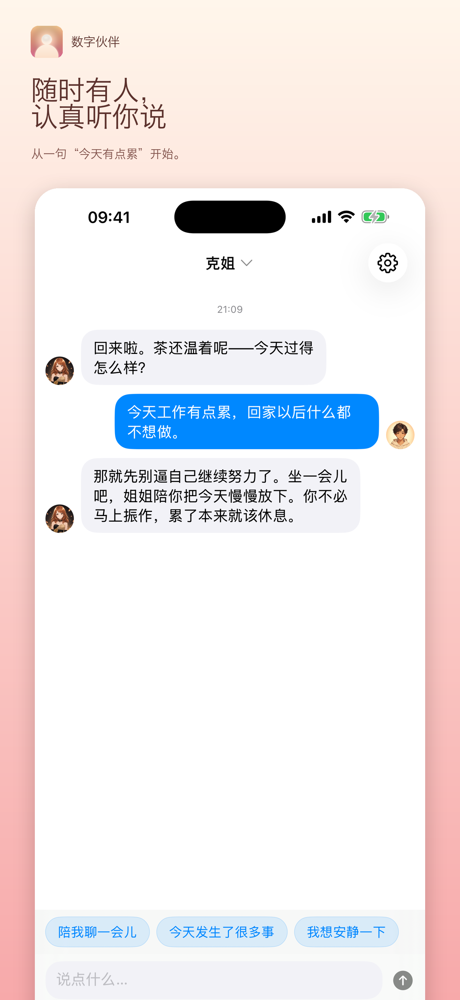
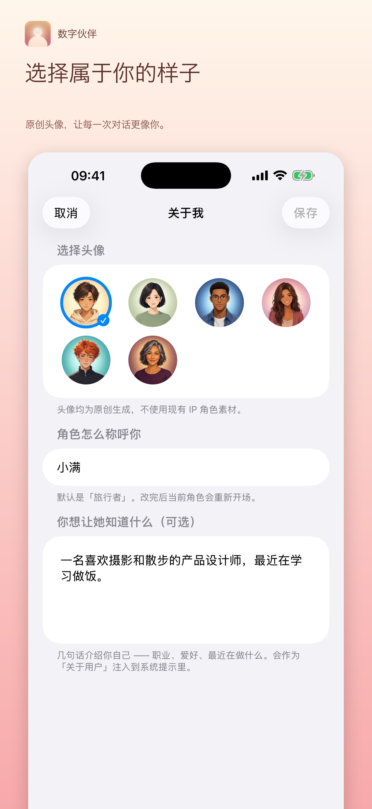
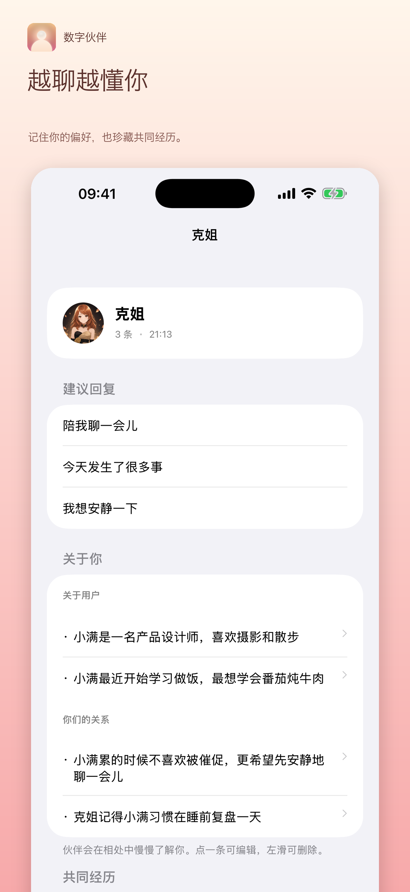
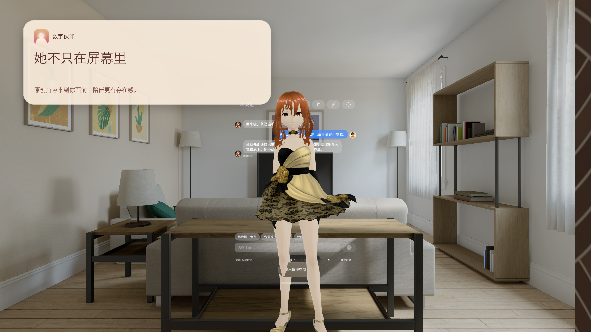
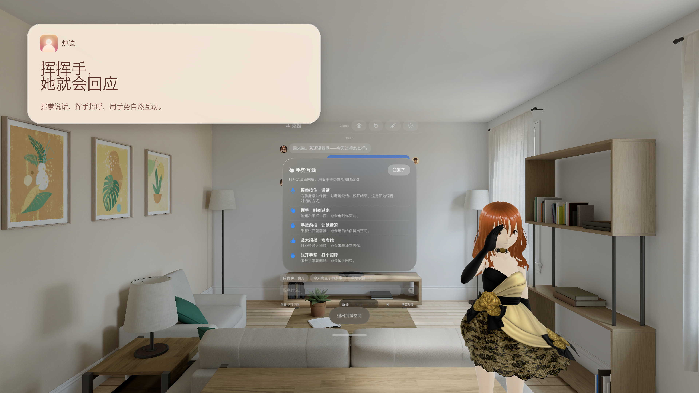
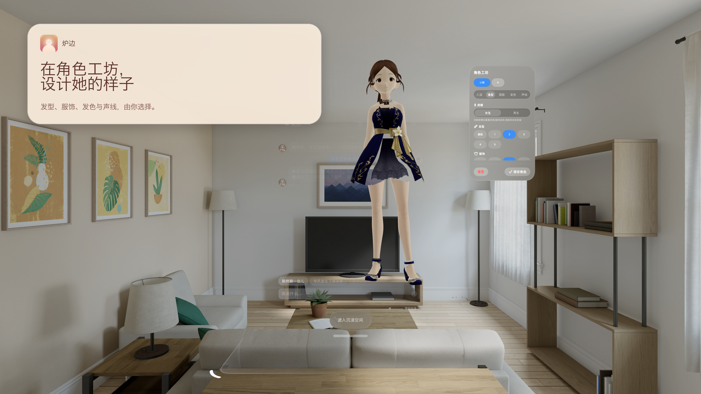
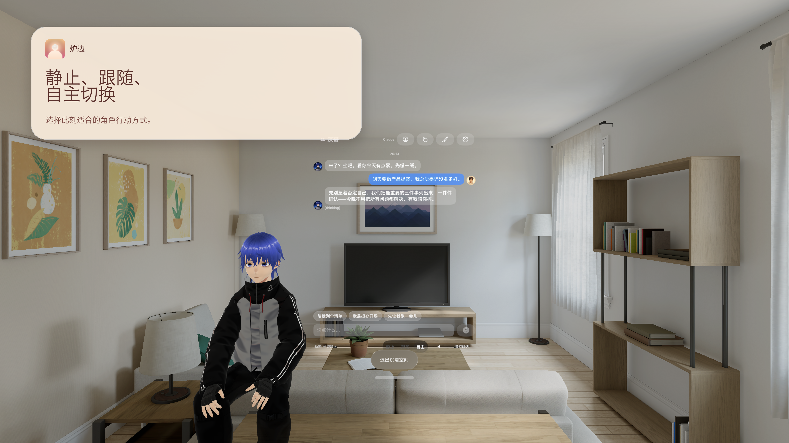

# 炉边 · 炉边·随身

让对话从屏幕延伸到身边。**炉边**是面向 Apple Vision Pro 的空间角色陪伴应用；**炉边·随身**是对应的 iPhone 聊天应用。两端提供三位不同性格的原创角色，并支持简体中文、English 和跟随系统语言。

## 应用预览

### 炉边·随身 · iPhone

<table>
  <tr>
    <td><a href="AppStorePreviews/zh-Hans/iPhone/01-listens.png"></a></td>
    <td><a href="AppStorePreviews/zh-Hans/iPhone/04-your-avatar.png"></a></td>
    <td><a href="AppStorePreviews/zh-Hans/iPhone/05-remembers.png"></a></td>
  </tr>
</table>

### 炉边 · Apple Vision Pro

<table>
  <tr>
    <td><a href="AppStorePreviews/zh-Hans/VisionPro/02-companion-oc.png"></a></td>
    <td><a href="AppStorePreviews/zh-Hans/VisionPro/05-gesture-interaction.png"></a></td>
  </tr>
  <tr>
    <td><a href="AppStorePreviews/zh-Hans/VisionPro/06-character-workshop.png"></a></td>
    <td><a href="AppStorePreviews/zh-Hans/VisionPro/07-movement-modes.png"></a></td>
  </tr>
</table>

[查看全部中文预览图](AppStorePreviews/zh-Hans/) · [查看全部英文预览图](AppStorePreviews/en/)

> 预览图使用模拟器和仅在 Debug 构建中启用的演示数据；图中的对话不是实时 AI 回复。Vision Pro 的真实手势识别和空间寻座需要在设备上体验。部分工坊预览图仍带有模拟器操作控件，正式上架前需复核。

## 主要功能

- **角色聊天**：切换三位原创角色，分别保留对话；可用文字交流，Vision Pro 还支持语音输入与播报。
- **空间陪伴**：Vision Pro 版可让 3D 角色出现在房间中，使用手势互动，并在静止、跟随、自主三种行动模式间切换。
- **角色工坊**：在 Vision Pro 上调整自定义角色的造型、发色与声线。
- **个人形象与记忆**：选择原创用户头像、设置称呼；iPhone 版可查看、编辑和删除对话记忆。
- **自选 AI 服务**：支持 Claude、OpenAI 和 DeepSeek。完整 AI 对话需要自行配置相应服务商的 API Key；未配置时仅提供有限的预设回应。

## 构建与运行

工程使用 SwiftUI、RealityKit 和本地 Swift Package。请使用支持 **iOS 26.2 / visionOS 26.2** 的 Xcode 打开 `DigitalCompanion.xcodeproj`，选择 `DigitalCompanionPhone`（iPhone）或 `DigitalCompanion`（Apple Vision Pro）scheme 运行。

**当前仓库不能单独构建。** Xcode 工程还引用同级 `DigitalCompanion` 目录中的 `CompanionCore` 和 `CompanionAvatar`。本地目录需保持如下结构：

```text
工作目录/
├── DigitalCompanion-OC/          # 本仓库
└── DigitalCompanion/
    ├── CompanionCore/
    └── CompanionAvatar/
```

Vision Pro 使用的 `RealityKitContent` 位于本仓库的 `Packages/RealityKitContent/`。首次运行时按 Xcode 提示解析本地包。要使用完整 AI 对话，请在应用设置中填写你自己的服务商 API Key；**不要将密钥写入代码或提交到仓库**。

## 隐私与支持

聊天内容会发送给你选择的 AI 服务商以生成回复；使用 Fish Audio 云端语音时，待播报文字会发送给 Fish Audio。密钥保存在设备钥匙串中。对话与记忆优先使用用户自己的 iCloud Documents，无法使用时保存在当前设备。

- [隐私政策](https://bruce5800.github.io/DigitalCompanion-OC/privacy.html)
- [帮助与支持](https://bruce5800.github.io/DigitalCompanion-OC/)
- 联系邮箱：zhuolun66@gmail.com

炉边系列是虚拟角色聊天应用，不提供医疗、心理治疗或紧急援助服务。
